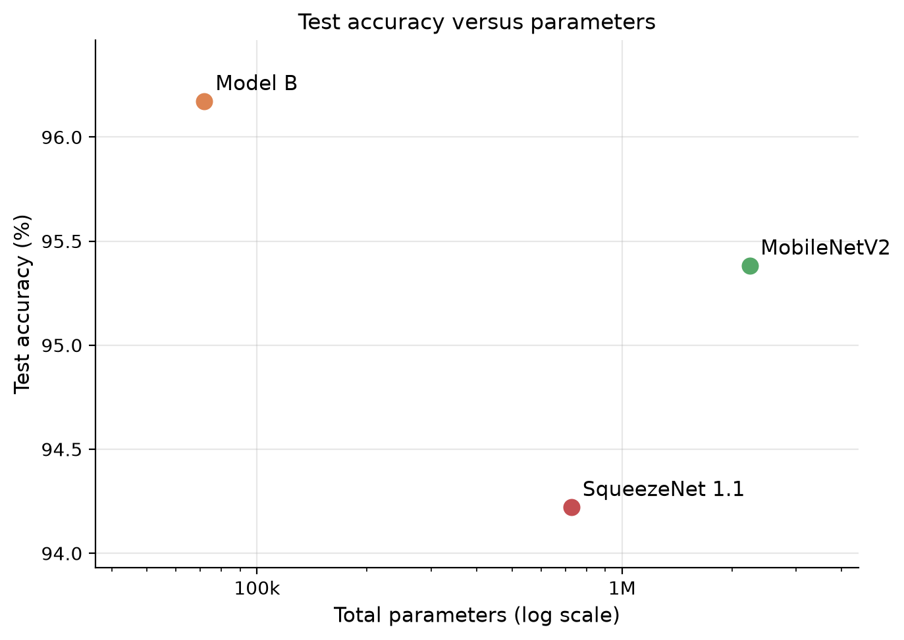
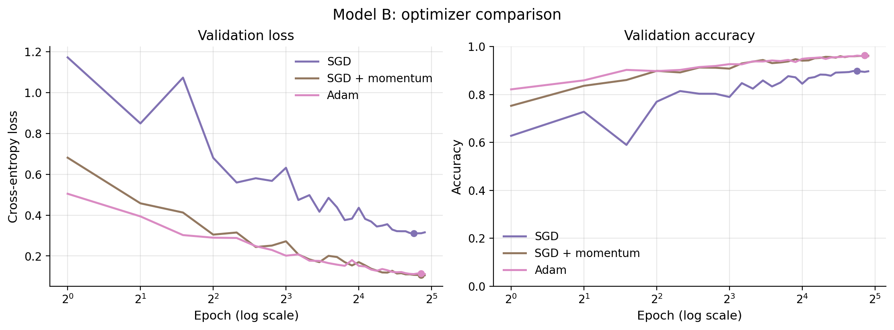

# CNNs for land-cover classification on small devices

**EN3150 Assignment 03, group Misclassified.**

How much accuracy does an image classifier need to give up to run on a small, low-power device,
and what does it gain in return? This project trains two convolutional networks of our own design
on satellite images, fine-tunes two well-known lightweight networks on the same data, and measures
each model's accuracy against what it costs to store and to run: parameters, size on disk,
multiply-accumulates, CPU latency and peak memory.

| | |
|---|---|
| **Dataset** | EuroSAT: 27,000 Sentinel-2 satellite images, 64×64 pixels, 10 land-cover classes |
| **Models** | Model A (standard CNN), Model B (depthwise-separable CNN under 100,000 parameters), MobileNetV2 and SqueezeNet 1.1 (pretrained on ImageNet) |
| **Framework** | PyTorch |
| **Code we submit** | [`submission/Misclassified_A03_EN3150/`](submission/Misclassified_A03_EN3150/): seven self-contained notebooks |
| **Report** | `Misclassified_A03_EN3150.pdf` |

---

## Results

All four models were trained and tested on the same split. Test accuracy is measured on 4,050
held-out images; latency is one image at a time on one CPU thread.

| Model | Parameters | Size | MACs per image | CPU latency | Peak memory | Test accuracy |
|---|---:|---:|---:|---:|---:|---:|
| Model A | 1,143,466 | 4,475 KB | 42.3 M | 3.30 ms | 5.36 MB | 95.85% |
| **Model B** | **71,818** | **304 KB** | **13.0 M** | 3.40 ms | **1.28 MB** | **96.17%** |
| MobileNetV2 | 2,236,682 | 8,971 KB | 24.5 M | 6.22 ms | 9.41 MB | 95.38% |
| SqueezeNet 1.1 | 727,626 | 2,861 KB | 17.0 M | 3.29 ms | 3.07 MB | 94.22% |

Of the pretrained models' parameters, only the fine-tuned part was trained: 1,218,890 of
MobileNetV2's and 391,306 of SqueezeNet's. A device must still store all of them.

Model B with three optimizers:

| Optimizer | Learning rate | Test accuracy | Best validation accuracy | Epoch reaching 90% of its best |
|---|---:|---:|---:|---:|
| SGD | 0.01 | 90.25% | 89.83% | 5 |
| SGD + momentum (0.9) | 0.01 | 96.32% | 96.25% | 4 |
| Adam | 0.001 | 96.17% | 96.25% | 3 |

**What the results show**

- **Model B is the most accurate of the four models** while having 16 times fewer parameters than
  Model A, 31 times fewer than MobileNetV2, and the smallest peak memory by far.
- **Fewer computations did not mean a faster model.** Model B needs 3.3 times fewer
  multiply-accumulates than Model A, yet the two take 3.40 and 3.30 ms per image on one CPU thread.
  A likely reason: depthwise convolutions do little arithmetic for each value they read from
  memory, so the processor spends more of its time moving data than computing.
- **Momentum is what makes SGD work here:** it lifts test accuracy from 90.25% to 96.32%, level
  with Adam. Adam converges fastest.
- **The pretrained models are handicapped by the 64×64 input,** which they were not designed for:
  MobileNetV2's total stride of 32 leaves a 2×2 feature map. They were deliberately not upsampled
  to their native 224×224, so that every model's cost is measured at the resolution the sensor
  produces.

  
  

Every table, figure, training curve and confusion matrix is in
[`submission/Misclassified_A03_EN3150/results/`](submission/Misclassified_A03_EN3150/results/).

---

## Method

- **Data.** EuroSAT through torchvision, split 70 / 15 / 15 (18,900 / 4,050 / 4,050 images),
  stratified by class, with a fixed seed. Normalisation statistics come from the training images
  only. Training images are randomly flipped and turned by quarter turns in every epoch; validation
  and test images never are.
- **Model A** stacks three blocks of 3×3 convolution, batch normalisation, ReLU and max pooling,
  then a fully connected head on the flattened feature maps. It is the unconstrained reference.
- **Model B** uses a standard 3×3 stem, four depthwise-separable blocks, global average pooling and
  ReLU6 activations. Its parameter budget is checked by an automated test.
- **MobileNetV2 and SqueezeNet 1.1** start from ImageNet weights. Their classifiers are replaced by
  a 10-class layer, and only that layer and the last few feature blocks are fine-tuned, the blocks
  at a tenth of the learning rate. Inputs are normalised with ImageNet's statistics.
- **Training.** One training loop for all models: 30 epochs, batch size 64, cosine learning-rate
  decay, early stopping on validation accuracy (never before epoch 20). The checkpoint with the
  best validation accuracy is evaluated once on the test split.
- **Evaluation.** Accuracy, macro-averaged precision, recall and F1, and confusion matrices.
- **Costs.** Measured by one code path for every model: parameters, the size of the saved weights,
  multiply-accumulates of convolutions and fully connected layers, single-thread CPU latency at batch
  size 1 (mean of 100 runs after 10 warm-up runs), and peak memory worked out from the model's
  graph.
- **Hardware.** Training on an NVIDIA T4 (Google Colab); latency on an Intel Core i5-11400H.

## Reproducing the results

- **The submitted notebooks:** [`submission/Misclassified_A03_EN3150/`](submission/Misclassified_A03_EN3150/)
  holds seven notebooks that contain all their code. Run them in order, locally or on Google Colab;
  its README gives the steps. Training takes about 40 minutes on a T4.
- **The development setup:** the library in `src/edgecnn/`, its notebooks, configuration and tests.
  See [DEVELOPMENT.md](DEVELOPMENT.md).

Every random choice uses seed 42, and the split's SHA-256 fingerprint is checked before training.
On a T4, three complete training runs produced identical accuracies, losses and confusion matrices;
only the timings differed. The latencies above come from the submission run; the development run's
latencies in `results/` were measured in an earlier session and differ by a few percent.

## Repository map

| Path | Contents |
|---|---|
| [`submission/Misclassified_A03_EN3150/`](submission/Misclassified_A03_EN3150/) | the code we submit, with its results |
| [`notebooks/`](notebooks/) | the development notebooks, one per assignment part, with the outputs of their official runs |
| [`src/edgecnn/`](src/edgecnn/) | the library those notebooks call: data, models, training, evaluation |
| [`configs/`](configs/) | the settings of every run |
| [`data/splits/`](data/splits/) | the train / validation / test split, committed |
| [`results/`](results/) | metrics, figures and tables of the development runs |
| [`tests/`](tests/) | automated tests |
| [`tools/`](tools/) | building, checking and running the submission |
| [`report/`](report/) | the report |

Developer documentation: [DEVELOPMENT.md](DEVELOPMENT.md) (how the project is organised),
[CONTRIBUTING.md](CONTRIBUTING.md) (workflow), [COLAB.md](COLAB.md) (running on Colab) and
[SUBMISSION.md](SUBMISSION.md) (how the submission is built).

## References

- P. Helber, B. Bischke, A. Dengel and D. Borth, "EuroSAT: A Novel Dataset and Deep Learning
  Benchmark for Land Use and Land Cover Classification", IEEE Journal of Selected Topics in Applied
  Earth Observations and Remote Sensing, 2019.
- M. Sandler, A. Howard, M. Zhu, A. Zhmoginov and L.-C. Chen, "MobileNetV2: Inverted Residuals and
  Linear Bottlenecks", CVPR 2018.
- F. N. Iandola, S. Han, M. W. Moskewicz, K. Ashraf, W. J. Dally and K. Keutzer, "SqueezeNet:
  AlexNet-level accuracy with 50x fewer parameters and <0.5MB model size", arXiv:1602.07360, 2016.
